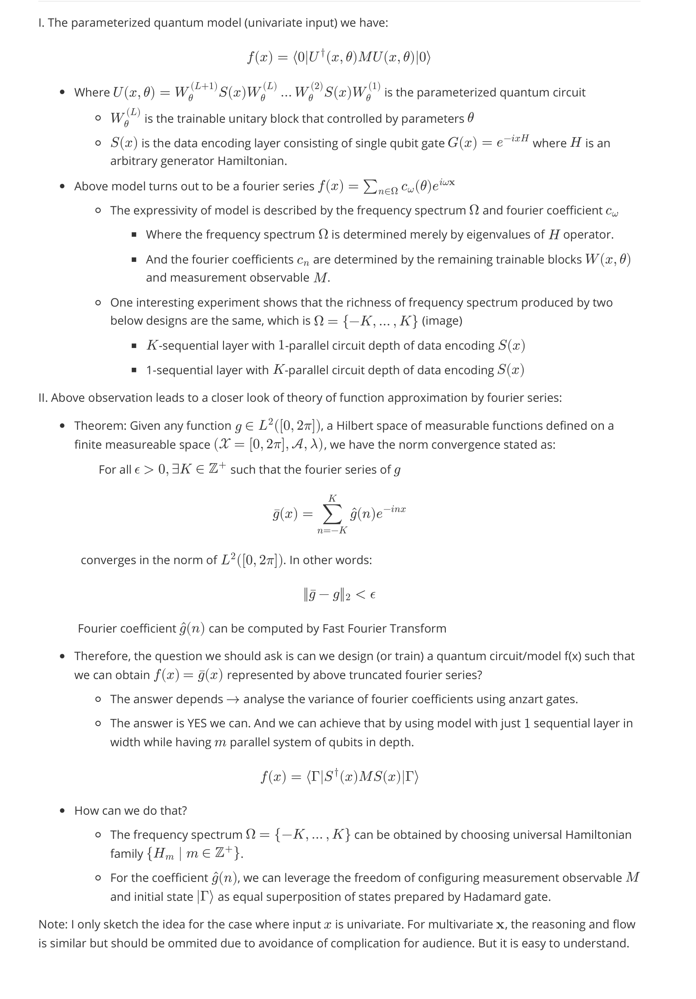

# Quantum Machine Learning

This repository contains my experiments and implementations (mainly in python and C++) of quantum machine learning models. Below is my draft presentation. Since the audience consists of undergraduate students, the mathematical content is reduced as much as possible.

## Quantum model as Fourier Series

  

